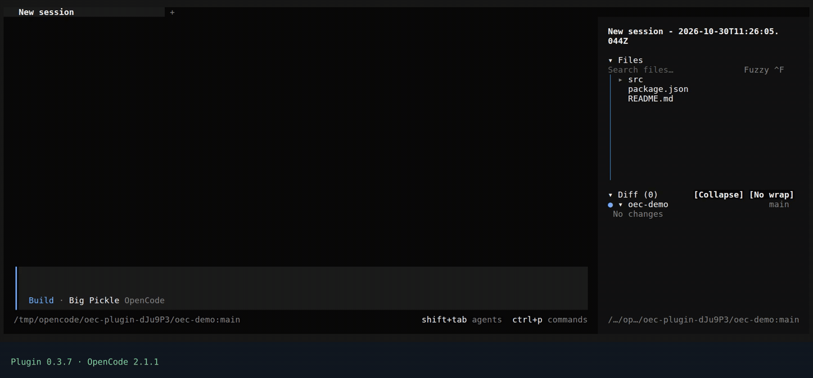
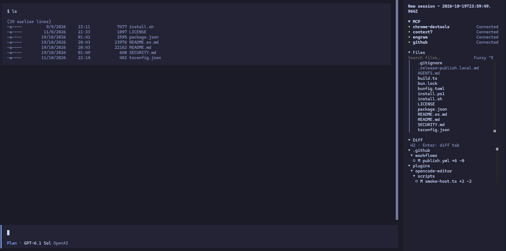
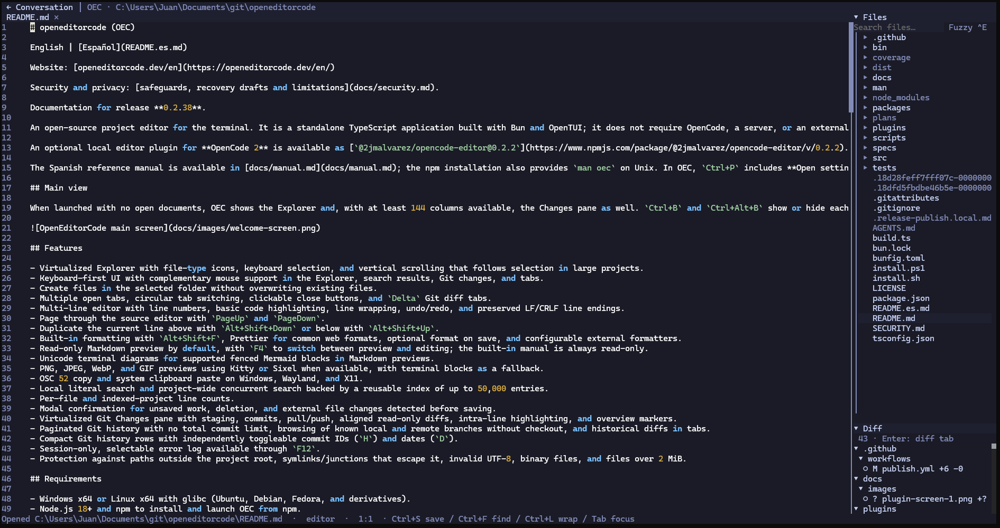
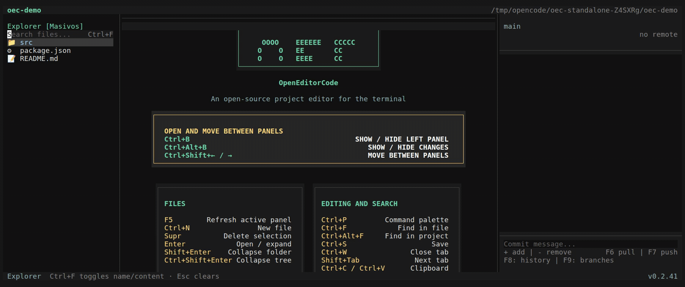
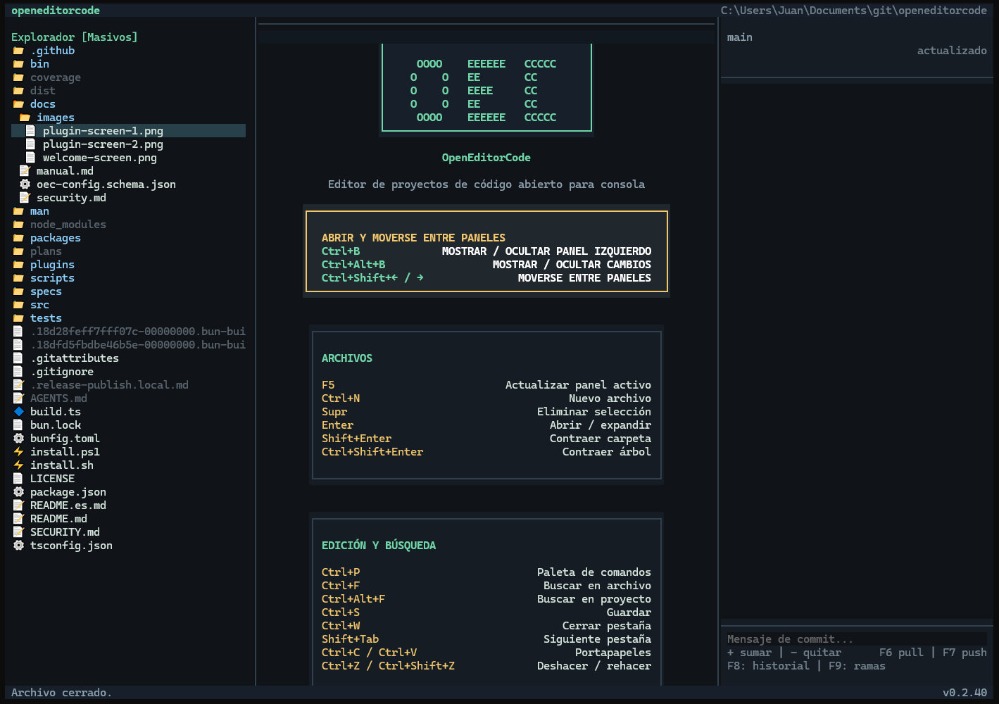

# openeditorcode (OEC)

Seguridad y privacidad: [protecciones, borradores y limitaciones](docs/security.md).

El plugin opcional [`@2jmalvarez/opencode-editor@0.3.4`](https://www.npmjs.com/package/@2jmalvarez/opencode-editor/v/0.3.4) integra el editor local en **OpenCode 2**, con árboles Files/Diff y pestañas propias. `F6` alterna conversación/editor, `F7` muestra/oculta Files y `F8` alterna Diff. Lee Git local, incluido WSL, y abre diffs de solo lectura; `F4` abre el archivo actual o alterna preview Markdown/SVG. Incluye imágenes, renombrado `F2`, filtro por nombre/contenido, scroll estable, paneles expanded/compact y acciones contextuales en `Ctrl+P`, grupo **OEC: opencode-editor**. Consultar la [guía del plugin](plugins/opencode-editor/README.md). Instalar `openeditorcode` no instala este plugin. OEC autónomo permanece independiente; ambos editores admiten `Ctrl+A` para seleccionar todo el archivo activo.

El plugin 0.3.4 pasó la matriz Windows/Linux con OpenCode 2.0.26, 2.0.27, 2.1.0 y 2.1.1. Para OpenCode 2.1.x usar 0.3.1 o posterior; versiones anteriores del plugin no son compatibles con sus requisitos de propietario de recursos OpenTUI.

### Demo del plugin



Grabado con el plugin **0.3.4** y OpenCode **2.1.1**, en una sesión vacía de ejemplo y sin consultas a modelos. [Ver con controles de reproducción](https://openeditorcode.dev/es/#plugin-demo).

<details>
<summary>Capturas del plugin OpenCode</summary>




</details>

[English](README.md) | Español

Sitio web: [openeditorcode.dev/es](https://openeditorcode.dev/es/)

♥ [Apoya OEC en GitHub Sponsors](https://github.com/sponsors/2jmalvarez)

Documentación para **0.2.43** ([release](https://github.com/2jmalvarez/openeditorcode/releases/tag/v0.2.43)). La publicación verifica Windows y Linux antes de anunciar la actualización npm.

Novedades de **0.2.43**: la búsqueda de archivos respeta reglas `.gitignore` anidadas. El plugin **0.3.7**, con publicación independiente, añade interfaz en español/inglés, controles Diff adaptables y ajuste de nombres de repositorios y ramas, conservando el estado y scroll de los paneles.

Las actualizaciones solo se ofrecen cuando están disponibles en npm los metadatos y las descargas del launcher y de tu plataforma. Una release incompleta conserva la instalación actual sin modificarla. La publicación verifica ambos paquetes de plataforma antes de publicar el launcher.

Editor de proyectos de código abierto para terminal. Es una aplicación autónoma escrita en TypeScript con Bun y OpenTUI; no necesita OpenCode, servidor ni conexión externa.

La referencia completa está en [docs/manual.md](docs/manual.md); la instalación npm también ofrece `man oec` en Unix. Desde OEC, `Ctrl+P` incluye **Abrir configuración de OEC** y **Abrir manual de OEC**.

## Apoya el proyecto

Si OEC o su plugin de OpenCode te resultan útiles, puedes apoyar su desarrollo y mantenimiento con un [aporte único o mensual a través de GitHub Sponsors](https://github.com/sponsors/2jmalvarez). Los aportes van a la cuenta personal del mantenedor, **@2jmalvarez**. El apoyo es opcional; OEC y el plugin siguen siendo de código abierto.

## Vista principal



Grabado con OEC autónomo **0.2.41**. [Ver con controles de reproducción](https://openeditorcode.dev/es/#standalone-demo).

Al iniciar sin documentos abiertos, OEC muestra el Explorador y, cuando hay al menos 144 columnas disponibles, tambien el panel de Cambios. `F7` y `F8` muestran u ocultan cada lateral, igual que en el plugin, mientras que `Ctrl+Shift+Izquierda/Derecha` mueve el foco entre paneles. El botón medio cierra desde cualquier parte de la pestaña; los cambios sin guardar siguen pidiendo confirmación. Debajo se muestran los demas atajos organizados por capacidad. Si el area central queda mas angosta que el Explorador, la ayuda se oculta y solo se muestra `OEC` en vertical.



## Caracteristicas

- Explorador virtualizado con iconos por tipo de archivo, seleccion por teclado y scroll vertical que sigue la seleccion incluso en proyectos grandes.
- Interfaz operable con teclado y soporte complementario de raton en el Explorador, resultados de busqueda, Cambios y pestanas.
- Creacion de archivos en la carpeta seleccionada, sin sobrescribir archivos existentes.
- Varias pestanas abiertas, cambio circular, cierre clicable y pestanas de diff Git `Delta`.
- Editor multilinea con numeros de linea, resaltado basico para codigo, ajuste de linea, deshacer/rehacer y conservacion de finales LF/CRLF.
- Navegacion por pantallas en el editor de fuente con `RePag` y `AvPag`.
- Duplicar la linea actual arriba con `Alt+Shift+Abajo` o abajo con `Alt+Shift+Arriba`.
- Formateo integrado con `Alt+Shift+F`, Prettier para formatos web comunes, formateo al guardar opcional y formateadores externos configurables.
- Preview Markdown de solo lectura por defecto, con `F4` para alternar preview y edicion; el manual interno nunca se puede editar.
- Preview SVG con `F4` para editar el XML y previsualizar los cambios sin guardar.
- Diagramas Unicode de terminal para bloques Mermaid compatibles en previews Markdown.
- Preview de PNG, JPEG, WebP y GIF en Kitty/Sixel cuando estan disponibles, con fallback de bloques de terminal.
- Copia mediante OSC 52 y pegado desde el portapapeles del sistema en Windows, Wayland y X11.
- Busqueda local literal y busqueda global concurrente con indice reutilizable de hasta 50.000 entradas.
- Conteo de lineas por archivo y del proyecto indexado.
- Confirmacion modal para cambios sin guardar, eliminacion y cambios externos detectados antes de guardar.
- Panel Git virtualizado con staging, commits, pull/push, diffs alineados de solo lectura, resaltado intralinea y marcadores laterales.
- Historial Git paginado sin limite total de commits, navegacion de ramas locales y remotas conocidas sin checkout y diffs historicos en pestanas.
- Filas compactas del historial Git con IDs de commit (`H`) y fechas (`D`) conmutables de forma independiente.
- Registro de errores de sesion seleccionable mediante `F12`.
- Proteccion contra rutas externas, symlinks/junctions que salen de la raiz, UTF-8 invalido, binarios y archivos de mas de 2 MiB.

## Requisitos

- Windows x64 o Linux x64 con glibc (Ubuntu, Debian, Fedora y derivados).
- Node.js 18+ y npm para instalar e iniciar OEC desde npm.
- Bun 1.3 o posterior solo para desarrollo.
- Git para el panel de Cambios Git.
- En Linux, `wl-paste` (Wayland), `xclip` o `xsel` para pegar desde el portapapeles del sistema.

## Instalacion

Instala OEC globalmente desde npm:

```bash
npm install -g openeditorcode
```

El aviso de instalacion sigue el idioma del sistema operativo: espanol (`es`) para variantes espanolas e ingles (`en`) para el resto. npm puede ocultar la salida de los scripts de ciclo de vida (lifecycle); usa `npm install -g openeditorcode --foreground-scripts` para verla. Con `--ignore-scripts` no se ejecuta el aviso.

### Instalacion directa (solo Linux x64 / WSL)

Disponible desde **0.2.24**, requiere Linux x64 con glibc (incluida una distribucion WSL compatible), Bash, curl y utilidades estandar de Linux como `sha256sum`, pero no Node.js, npm ni Bun. No admite Windows nativo, macOS ni ARM64. El instalador verifica el checksum SHA-256 y la version informada por el binario de la release antes de instalarlo. Sus mensajes usan espanol para variantes espanolas e ingles para el resto.

```bash
curl -fsSL https://raw.githubusercontent.com/2jmalvarez/openeditorcode/main/install.sh | bash
```

Para elegir una version publicada o no modificar los archivos de inicio del shell:

```bash
curl -fsSL https://raw.githubusercontent.com/2jmalvarez/openeditorcode/main/install.sh | bash -s -- --version <VERSION> --no-modify-path
```

Sustituye `<VERSION>` por una version de release a partir de `0.2.24`, sin escribir los signos angulares. Sin `--version`, el instalador elige la ultima release estable de GitHub. Ambos aliases, `oec` y `openeditorcode`, quedan en `~/.local/bin`. Reinicia el shell tras configurar PATH o ejecuta `export PATH="$HOME/.local/bin:$PATH"` en Bash/Zsh para la sesion actual. Con `--no-modify-path`, agrega ese directorio a PATH por tu cuenta si hace falta.

Cierra OEC y repite el instalador para actualizar la misma instalacion directa; no ejecuta npm ni crea una segunda instalacion npm. Elige un solo metodo para evitar comandos en conflicto en PATH. Para desinstalar la instalacion directa y su marcador de propiedad, ejecuta `rm -f "$HOME/.local/bin/oec" "$HOME/.local/bin/openeditorcode" "$HOME/.local/bin/.oec-install-sh.sha256"`; elimina la entrada PATH agregada por el instalador en el archivo de inicio del shell solo si ya no la necesitas. Se conserva la configuracion del usuario. Para una instalacion npm, usa en cambio `npm uninstall -g openeditorcode`.

### Instalacion directa (Windows x64 / PowerShell)

Sin Node.js, npm, Bun ni permisos de administrador. En PowerShell 5.1 o posterior:

```powershell
& ([scriptblock]::Create((Invoke-WebRequest -UseBasicParsing 'https://raw.githubusercontent.com/2jmalvarez/openeditorcode/main/install.ps1').Content))
oec .
```

El instalador descarga la ultima release estable, verifica SHA-256 y la version, y guarda `oec.exe` en `%LOCALAPPDATA%\Programs\OpenEditorCode\bin`. Agrega esa carpeta al PATH del usuario sin duplicarla y actualiza la sesion actual. No modifica el PATH del sistema ni necesita cambiar la politica de ejecucion. Puedes descargar e inspeccionar el script antes de ejecutarlo.

Para elegir una version o no modificar PATH:

```powershell
& ([scriptblock]::Create((Invoke-WebRequest -UseBasicParsing 'https://raw.githubusercontent.com/2jmalvarez/openeditorcode/main/install.ps1').Content)) -Version 0.2.40 -NoModifyPath
& "$env:LOCALAPPDATA\Programs\OpenEditorCode\bin\oec.exe" .
```

Cierra OEC y repite el instalador para actualizar. No sobrescribe ejecutables ajenos o modificados; si falla la descarga o su validacion, conserva la instalacion anterior. Elige npm o instalacion directa para evitar comandos en conflicto en PATH. Este metodo instala el comando `oec` (no el alias `openeditorcode`). Para desinstalar, elimina `oec.exe` y `.oec-install-ps1.sha256` de esa carpeta y quita solo esa entrada del PATH del usuario desde Variables de entorno. La configuracion y los proyectos se conservan.

### Inicio y version

Despues, abre el editor en el directorio actual o indica la carpeta del proyecto:

```bash
oec
oec /ruta/del/proyecto
openeditorcode
openeditorcode /ruta/del/proyecto
```

`oec` y `openeditorcode` son comandos equivalentes. Usa `--` antes de una ruta de proyecto que empiece por guion.

Tambien puedes consultar la ayuda y la version sin iniciar la interfaz:

```bash
oec --help
oec -h
oec --version
oec -V
oec -v
```

`-v`, `-V` y `--version` son equivalentes para ambos aliases. `--version <VERSION>` del instalador elige la release a instalar; `--version` del editor solo imprime la version instalada.

Al iniciarse mediante npm, OEC comprueba actualizaciones en segundo plano salvo que `updates.checkOnStartup` sea falso. Si hay una version nueva, la muestra junto a la version actual. **Actualizar OEC** aparece en `Ctrl+P` solo para ese modo de inicio; cierra el editor, actualiza la instalacion desde la que se ejecuto (tambien con prefijos npm personalizados) usando el registro publico para OEC y su paquete de plataforma, y vuelve a abrir el mismo proyecto. No cambia el registro configurado en npm. Si falla la instalacion o la verificacion de versiones, reabre el binario anterior desde una copia temporal. Los binarios directos no consultan npm ni ofrecen su accion de actualizacion; se actualizan repitiendo el instalador directo indicado arriba.

Si una version antigua intenta instalar desde un registro privado y devuelve 404, consulta la reparacion de esa instalacion en [el manual](docs/manual.md#git-y-actualizaciones). El lanzador antiguo no puede actualizarse por medio de la descarga que esta fallando.

La instalacion npm incluye unicamente el lanzador y el binario de la plataforma actual; las dependencias de compilacion no se instalan globalmente.

## Configuracion e idioma

OEC mantiene su configuracion fuera de los proyectos y fuera de la instalacion npm, por lo que se conserva al actualizar:

- Windows: `%APPDATA%\openeditorcode\config.json`.
- Linux: `${XDG_CONFIG_HOME:-~/.config}/openeditorcode/config.json`.
- Entornos administrados o pruebas: `OEC_CONFIG_DIR` permite indicar el directorio de configuracion.

Abre la paleta con `Ctrl+P` y selecciona **Abrir configuración** para modificar preferencias comunes desde la TUI o editar el JSON avanzado. Usa flechas arriba/abajo para elegir una preferencia, `Enter` para cambiarla, flechas izquierda/derecha para alternar entre ámbito global y proyecto, `E` para editar el JSON del ámbito activo y `Esc` para cerrar la pantalla. La configuración guardada se valida; consulta el esquema distribuido en [`docs/oec-config.schema.json`](docs/oec-config.schema.json). Incluye tema de sintaxis, formateo, atajos y el perfil Vim básico. Un proyecto puede sobrescribir preferencias en `.oec/config.json`; esos valores tienen prioridad, pero la configuración de proyecto no puede declarar ejecutables de formateadores externos.

Los atajos predeterminados de la tabla se pueden sobrescribir mediante `keyboard.bindings`. `keyboard.profile: "vim"` habilita modos Normal, Insert y Visual básicos; no es una emulación completa de Vim. La navegación compatible en Normal/Visual es `h`, `j`, `k`, `l`, `w`, `b`, `0` y `$`; el modo Normal también admite `i`, `a`, `v`, `u`, `x`, `dd` y `gg`.

El idioma predeterminado es el del sistema. `appearance.language` acepta `"auto"`, `"es"` y `"en"`.

Las configuraciones de versiones anteriores se migran automaticamente. Si el JSON es invalido, tiene valores incompatibles o impide iniciar OEC, se conserva la version problematica en `config.bkp.json` y se restaura `config.json` con valores de fabrica. El backup es unico y se reemplaza en cada recuperacion; OEC muestra un aviso al iniciar tras una restauracion.

Las exclusiones que se agregan con `Ctrl+E` son deliberadamente temporales: no se escriben ni en `.gitignore` ni en `config.json`.

## Ejecutar desde codigo fuente

Desde la carpeta del proyecto `openeditorcode`:

```powershell
bun install
bun run dev
```

Para abrir otro proyecto durante el desarrollo:

```powershell
bun run dev -- C:\ruta\del\proyecto
```

Sin argumento, abre el directorio actual. Tras compilar para Windows, el ejecutable queda en `packages\oec-win32-x64\bin\oec.exe`:

```powershell
.\packages\oec-win32-x64\bin\oec.exe
```

## Uso basico

1. Pulsa `F7` para mostrar u ocultar el Explorador.
2. Usa las flechas para mover la seleccion.
3. Pulsa `Enter` para expandir una carpeta o abrir un archivo.
4. Usa `Tab` para alternar entre Explorador, Editor y Cambios.
5. Guarda con `Ctrl+S`.

Al cerrar una pestana modificada, el dialogo muestra **Guardar**, **Guardar y cerrar** y **Cerrar sin guardar** (opcion predeterminada). Usa flechas arriba/abajo y confirma con `Enter`. Si un archivo cambia fuera de OEC antes de guardar, puedes recargarlo, sobrescribirlo o cancelar.

El Explorador tiene un filtro siempre visible por nombre/ruta con resultados en árbol. `Ctrl+F` alterna ese mismo campo entre nombre/ruta y búsqueda simple por contenido; en el Editor busca dentro del archivo abierto. `Esc` limpia la consulta sin ocultar el campo y restaura el árbol normal. La búsqueda avanzada `Ctrl+Alt+F` sigue igual: conserva consulta, resultados y selección al abrir un resultado, reutiliza el índice durante la sesión y se limpia con `Esc` desde el modal.

Los Markdown (`.md`, `.markdown`, `.mdown` y `.mkd`) se abren como preview renderizado por defecto. `F4` alterna entre la fuente editable y el preview, conservando los cambios sin guardar. Los bloques fenced `mermaid` se muestran como diagramas Unicode de terminal para flowcharts, estados, secuencias, clases, ER y graficos XY; los diagramas no compatibles o invalidos permanecen visibles como codigo fuente. El manual que se abre desde la paleta siempre permanece en preview y es de solo lectura. PNG, JPEG, WebP y GIF se muestran como previews de solo lectura; OEC prefiere Kitty o Sixel cuando el terminal lo soporta y usa bloques de terminal como fallback.

Los SVG tambien abren en preview: `F4` alterna el XML editable y el borrador actual sin guardar. Un SVG invalido muestra un aviso y permite volver al codigo con `F4`. El render es local y estatico, con fuente embebida, sin scripts ni imagenes externas. Se aplica el limite de texto de 2 MiB y un raster de hasta 1600 pixeles por dimension. Con `preview.images: false`, SVG abre solo como codigo. Ver [licencias del renderer y de la fuente](docs/THIRD-PARTY-NOTICES.txt).

Cuando una operación falla, OEC conserva la operación, la hora y el detalle técnico en el registro de sesión. El pie indica `F12` mientras haya errores sin leer; `F12` o **Abrir registro de errores** desde la paleta abren una pestaña central de solo lectura que no se persiste al cerrar OEC.

## Paleta de comandos

Pulsa `Ctrl+P` para abrir la paleta de comandos, escribe para filtrar, usa las flechas para seleccionar y `Enter` para ejecutar. Desde ella puedes abrir la configuración global o del proyecto, el manual integrado, el registro de errores de sesión, el conteo de líneas del proyecto y la actualización de referencias remotas de Git. Cuando está disponible, también ofrece la actualización de OEC mediante npm.

Los comandos Git adicionales en `Ctrl+P` son **Git: ver historial de commits**, **Git: enviar cambios (push)**, **Git: ver todas las ramas** (`F9`) y, con un diff activo, **Abrir archivo del proyecto** (`F4`). Son las etiquetas actuales de la paleta; fuera de diffs, el comando `F4` conserva su accion de preview/edicion de Markdown.

El pie de Cambios ofrece botones para agregar, quitar del stage, descartar con confirmación, pull, push, historial y ramas. **Commit** está a la derecha del mensaje y solo se habilita con mensaje y cambios preparados. Con foco en Git: `F6` pull, `Shift+F6` push, `F9` ramas y `Shift+F9` historial; `F7`/`F8` siguen alternando paneles. Los controles cliqueables de OEC y del plugin muestran manito si el terminal admite OSC 22.

## Atajos

| Atajo | Accion |
| --- | --- |
| `Ctrl+P` | Paleta de comandos, atajos y configuracion |
| `Ctrl+Shift+Izquierda` | Mover el foco al panel de la izquierda |
| `Ctrl+Shift+Derecha` | Mover el foco al panel de la derecha |
| `F7` | Mostrar u ocultar el Explorador |
| `F8` | Mostrar u ocultar Cambios Git |
| `Ctrl+Shift+Enter` | Contraer todas las carpetas del panel activo |
| `F5` | Actualizar el panel activo; en Git ejecuta fetch, relee el estado local y refresca la vista historica cuando corresponde |
| `F10` | Abrir la carpeta del proyecto en una nueva ventana del explorador de archivos del sistema |
| `Ctrl+P` → Git: ver historial de commits | Abrir el historial completo paginado de la rama actual en el panel derecho |
| `F9` | Con foco en Git, listar ramas locales y remotas conocidas en el panel derecho |
| `F12` | Abrir el registro de errores de la sesion |
| `Supr` | Eliminar el archivo o carpeta seleccionado |
| `Ctrl+N` | Crear un archivo en la carpeta seleccionada |
| `F2` | Renombrar el archivo o carpeta seleccionado en el Explorador |
| `Shift+Enter` | Expandir o contraer recursivamente la carpeta seleccionada en Explorador; alternar en Cambios |
| `Ctrl+F` | Alternar filtro del Explorador entre nombre/ruta y contenido; buscar texto en el Editor |
| `Ctrl+Alt+F` | Buscar texto en todos los archivos del proyecto |
| `Ctrl+E` | Editar exclusiones temporales desde un buscador de proyecto |
| `Ctrl+S` | Guardar archivo actual |
| `Ctrl+W` | Cerrar pestana actual |
| `Shift+Tab` | Ir a la pestana siguiente |
| `Ctrl+C` | Copiar el texto seleccionado |
| `Ctrl+A` | Seleccionar todo el archivo activo (con foco en el editor) |
| `Ctrl+V` | Pegar desde el portapapeles del sistema |
| `Ctrl+Z` | Deshacer el ultimo cambio |
| `Ctrl+Shift+Z` | Rehacer el ultimo cambio |
| `RePag` / `AvPag` | Mover el cursor una pantalla arriba / abajo en el editor |
| `Alt+Shift+Abajo` / `Alt+Shift+Arriba` | Duplicar la linea actual arriba / abajo |
| `Alt+Shift+F` | Formatear el documento actual |
| `Ctrl+L` | Alternar ajuste de linea |
| `F4` | En un diff, abrir el archivo actual del proyecto sin cerrar el diff; fuera de diffs, alternar preview y edicion de Markdown / SVG |
| `Ctrl+Q` | Salir |
| `Tab` | Alternar Explorador, Editor y Cambios |
| `Esc` | Cerrar una busqueda o dialogo; en historial Git, retroceder un nivel hacia cambios locales sin cerrar diffs |

## Busqueda y conteo

- Explorador: escribe en el filtro permanente para buscar nombres/rutas, incluso dentro de carpetas cerradas. `Ctrl+F` alterna búsqueda simple por contenido en el mismo campo (literal, sin distinguir mayúsculas). Los resultados conservan sus carpetas padre; usa flechas y `Enter` para navegar/abrir. `Esc` limpia el filtro y restaura la expansión anterior del árbol. Abrir un archivo conserva el filtro para cuando vuelvas.
- `Ctrl+F` en el Editor: escribe el texto para ver todas las coincidencias locales. Usa flechas para elegir una y `Enter` para llevar el cursor a su inicio.
- `Ctrl+Alt+F`: escribe el texto y pulsa `Enter` para buscar en todo el proyecto. El primer uso construye un indice en memoria; los siguientes lo reutilizan. Tras obtener resultados, usa flechas para elegir uno y `Enter` para abrir el archivo en la linea coincidente.
- `Ctrl+E` dentro de la busqueda de archivos o la busqueda global abre las exclusiones de la sesion. Estas parten del `.gitignore` de raiz, autocompletan patrones y carpetas, y permiten incluir o excluir rutas sin modificar `.gitignore`. `.git` nunca se incluye.
- `Ctrl+P`: ejecuta **Calcular lineas del proyecto**. El Explorador mostrara el conteo a la derecha de cada archivo y el pie mostrara el total indexado. El conteo y las busquedas pueden ser parciales al alcanzar el limite de 50.000 entradas.
- El pie muestra un indicador giratorio mientras OEC abre, guarda, crea o elimina archivos, indexa, busca, cuenta lineas o actualiza el panel activo.

## Cambios Git

- Git es opcional. `F8` muestra el panel **CAMBIOS** cuando el proyecto es un repositorio Git. Los archivos preparados se separan en **STAGED** y el resto en **CAMBIOS**; usa flechas para seleccionar entradas y `Enter` para expandir o contraer carpetas y abrir diffs.
- El encabezado muestra la rama y su estado remoto: `actualizado`, `↑N` pendiente de push o `↓N` pendiente de pull. Cada cambio se numera y muestra sus lineas anadidas en verde y eliminadas en rojo. Un mismo archivo puede aparecer una vez en cada grupo; los binarios o estadisticas no disponibles se indican con `?`.
- En la vista local de Cambios, `+` suma el archivo o todo el contenido de una carpeta a **STAGED**. `-` quita archivos de **STAGED** o descarta los cambios de **CAMBIOS** tras confirmar.
- En la vista local de Cambios, baja desde el ultimo cambio para escribir el mensaje de commit; `Enter` crea el commit. `F6` ejecuta pull; **Git: enviar cambios (push)** en `Ctrl+P` ejecuta push. Las mutaciones Git (stage, unstage, descarte, commit, pull y push) se bloquean al navegar historial o ramas.
- Con foco en Git, `F5` ejecuta `git fetch` y vuelve a comprobar los cambios locales y sus estadisticas aunque el fetch falle. Tambien refresca el historial o la lista de ramas cuando corresponde, sin reemplazarlos por cambios locales. Configura `git.fetchOnRefresh` en `false` para omitir fetch manteniendo las lecturas locales.
- OEC muestra el estado remoto de la rama disponible localmente. La paleta incluye **Actualizar referencias remotas de Git** para ejecutar `git fetch --quiet` manualmente.
- Los directorios sin seguimiento se expanden en archivos individuales. Abrir una entrada crea una pestaña `Delta` con el diff preparado o no preparado correspondiente, por lo que ambos pueden convivir para una misma ruta. Cierra una pestaña diff con `Ctrl+W`. Los diffs son de solo lectura, alinean las líneas modificadas, resaltan fragmentos cambiados, sincronizan el scroll y muestran marcadores laterales. `layout.diffOrientation` acepta `auto`, `horizontal` o `vertical`; en `auto`, `layout.diffStackBelow` indica el ancho del terminal a partir del cual las dos versiones se apilan verticalmente.

- **Git: ver historial de commits** en `Ctrl+P` abre el historial completo de la rama actual en el panel derecho. Los commits se cargan por paginas al navegar, sin limite total. Con foco en Git, `F9` lista las ramas locales y remotas conocidas; las remotas son referencias disponibles localmente, no una lista consultada en vivo al servidor.
- En el historial de commits, `H` muestra u oculta los IDs abreviados y `D` muestra u oculta las fechas, dejando mas espacio para el asunto del commit.
- En el panel derecho, `Enter` sobre una rama abre sus commits sin checkout, sobre un commit abre sus archivos modificados y sobre un archivo abre un diff historico de solo lectura en una pestana, manteniendo el panel derecho abierto.
- Con foco en Git, `Esc` vuelve de archivos del commit a historial, luego a ramas si el historial se abrio desde esa lista y finalmente a cambios locales. Las pestanas diff abiertas se conservan durante toda la navegacion.
- En cualquier diff local, staged o historico, `F4` abre el archivo actual del proyecto sin cerrar el diff. No abre ni restaura la version historica. Si el archivo ya no existe, OEC muestra un aviso y no lo recrea. Fuera de diffs, `F4` sigue alternando preview/edicion de Markdown; el manual integrado permanece de solo lectura.

## Limites de seguridad

- Todas las rutas se validan contra la carpeta raiz seleccionada; los symlinks y junctions no pueden salir de ella.
- Solo se abren y procesan archivos de texto UTF-8; se rechazan binarios, NUL y UTF-8 invalido.
- El limite de lectura y analisis es 2 MiB por archivo.
- Los previews de imagenes aceptan PNG, JPEG, WebP y GIF hasta 16 MiB; formatos danados o no compatibles se informan sin cerrar OEC.
- Los guardados usan un archivo temporal antes de reemplazar el original y preservan sus finales de linea.
- El `.gitignore` de raiz se muestra en gris en el Explorador y se excluye por defecto del conteo y de los buscadores de proyecto. No se leen `.gitignore` anidados, `.git/info/exclude` ni exclusiones globales Git. Las busquedas permiten excepciones temporales durante la sesion; la carpeta `.git` permanece oculta y excluida siempre.

## Desarrollo, pruebas y distribucion

```powershell
bun run typecheck
bun run test
bun run test:coverage
bun run build
bun run smoke:tui
```

`bun run build` genera el binario de la plataforma actual. Tambien puedes ejecutar `bun run build:windows` o `bun run build:linux`. Para comprobaciones de release y paquetes, usa `bun run preflight`, `bun run smoke:check` y `bun run pack:check`. La CI ejecuta los umbrales de cobertura configurados y arranca el ejecutable compilado hasta verificar su primer frame. La publicacion de npm valida versiones, contenido de paquetes y binarios antes de distribuir los paquetes por sistema operativo. Consulta `AGENTS.md` para la arquitectura y pautas de mantenimiento.
